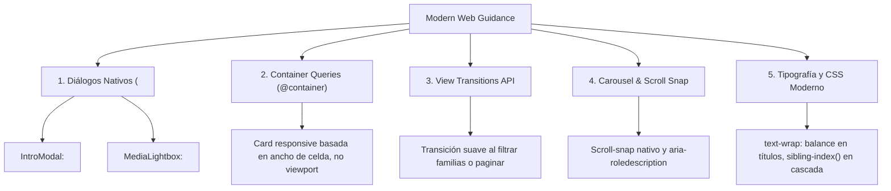

# Plan de Modernización: Haptic Cards con Modern Web Guidance

Este documento establece la propuesta técnica y de arquitectura frontend para modernizar el catálogo interactivo de **Haptic Cards** ([`Haptic_Cards/`](./)) aplicando las mejores prácticas y estándares de la plataforma web moderna documentados en [**Google Chrome Modern Web Guidance**](https://developer.chrome.com/docs/modern-web-guidance) (`modern-web-guidance`).

---

## 1. Motivación y Objetivos

El objetivo de esta modernización es:
1. **Reducir JavaScript prescindible** delegando al navegador primitivas nativas accesibles (`<dialog>`, CSS Container Queries, CSS Scroll Snap).
2. **Mejorar la accesibilidad (a11y)** asegurando foco nativo, control por teclado y soporte de lectores de pantalla sin capas manuales propensas a fallos.
3. **Optimizar el rendimiento y la fluidez visual** mediante animaciones basadas en `sibling-index()`, `@starting-style` y transiciones morfológicas con la View Transitions API.



---

## 2. Diagnóstico del Estado Actual vs. Modern Web Guidance

| Área | Implementación Actual | Propuesta con Modern Web Guidance |
| :--- | :--- | :--- |
| **Modales & Overlays** (`IntroModal.vue`, `MediaLightbox.vue`) | Capas manuales `fixed inset-0 z-50` con listeners globales de teclado para `Escape`, `role="dialog"` y `aria-modal="true"`. | Elemento nativo `<dialog>` con `.showModal()`, `::backdrop`, soporte automático de `Escape` y retorno de foco al elemento invocador. |
| **Diseño Adaptativo de Tarjetas** (`DeviceCard.vue`) | Media queries globales de viewport (`@media (min-width: 640px)`). | Container Queries (`container-type: inline-size` y `@container`) para adaptar el contenido al ancho real de cada tarjeta. |
| **Paginación & Filtro de Familias** (`useCatalog.ts`) | Reemplazo instantáneo y seco del DOM de tarjetas al paginar o filtrar. | `document.startViewTransition()` para animar el reordenamiento y entrada de tarjetas. |
| **Cascada de Animaciones** (`style.css`) | Reglas repetitivas fijas `:nth-child(2..4)` con delays manuales. | `animation-delay: calc(sibling-index() * 40ms)` dinámico y escalable. |
| **Tipografía de Tarjetas** | Quiebres de línea predeterminados que dejan palabras huérfanas en títulos largos. | `text-wrap: balance` en títulos y `text-wrap: pretty` en descripciones de mecanismos. |

---

## 3. Especificación Técnica por Componente

### 3.1. Diálogos Nativos con `<dialog>` (`IntroModal.vue` y `MediaLightbox.vue`)
* **Guía de referencia:** `modern-web-guidance/guides/ui-components/dialog.md`
* **Cambios:**
  - Sustituir el `<div>` exterior por `<dialog ref="dialogRef">`.
  - Abrir con `dialogRef.value.showModal()` y cerrar con `dialogRef.value.close()`.
  - Eliminar listeners manuales de `Escape` (el navegador los maneja nativamente).
  - Prevenir el scroll de fondo en la página:
    ```css
    dialog:modal {
      overscroll-behavior: contain;
    }
    dialog::backdrop {
      background: rgb(10 13 12 / 0.85);
      backdrop-filter: blur(4px);
      overflow: hidden;
      overscroll-behavior: contain;
    }
    ```
  - Animar entrada y salida con CSS nativo:
    ```css
    dialog {
      transition: opacity 0.25s ease, transform 0.25s ease, overlay 0.25s allow-discrete, display 0.25s allow-discrete;
      opacity: 0;
      transform: scale(0.96);
    }
    dialog[open] {
      opacity: 1;
      transform: scale(1);
    }
    @starting-style {
      dialog[open] {
        opacity: 0;
        transform: scale(0.96);
      }
    }
    ```

### 3.2. Container Queries en Tarjetas (`DeviceCard.vue`)
* **Guía de referencia:** `modern-web-guidance/guides/ui-components/card.md`
* **Cambios:**
  - Añadir a `.card-item`:
    ```css
    .card-item {
      container-type: inline-size;
      container-name: card;
    }
    ```
  - En `@container card (min-width: 360px)`, mostrar las etiquetas de sensaciones en dos columnas compactas con mayor legibilidad.

### 3.3. View Transitions API (`useCatalog.ts` & `App.vue`)
* **Guía de referencia:** `modern-web-guidance/guides/user-experience/page-transitions.md`
* **Cambios:**
  - Envolver los cambios de página y de familia en `document.startViewTransition`:
    ```ts
    function goToPage(newPage: number): void {
      if ('startViewTransition' in document) {
        document.startViewTransition(() => {
          state.value.page = newPage;
        });
      } else {
        state.value.page = newPage;
      }
    }
    ```

### 3.4. Animaciones Dinámicas y Tipografía
* **Guía de referencia:** `modern-web-guidance/guides/css/dynamic-sibling-animations.md` & `typography.md`
* **Cambios:**
  - Reemplazar las reglas estáticas `:nth-child` en `style.css` por `sibling-index()`.
  - Añadir a los encabezados `text-wrap: balance` y a las descripciones `text-wrap: pretty`.

---

## 4. Plan de Verificación

```bash
# 1. Pruebas unitarias y de integración de Haptic Cards
npx vitest run Haptic_Cards/

# 2. Comprobación estricta de tipos de TypeScript y Vue SFC
npm run typecheck

# 3. Comprobación de ESLint
npm run lint

# 4. Verificación de compilación y empaquetado Vite
npm run build
```

---

## 5. Criterios de Aceptación para Revisión
- [ ] Los modales (`IntroModal` y `MediaLightbox`) abren en el *top layer* nativo y cierran con `Escape` y click en backdrop.
- [ ] Las tarjetas responden adecuadamente al ancho de su contenedor (@container).
- [ ] La navegación entre páginas y familias de patrones se anima de forma fluida con View Transitions.
- [ ] Cero regresiones en la suite de 79 tests y build verde.
