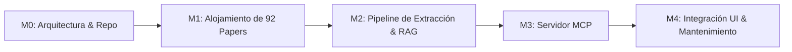

# Roadmap & Backlog: Haptic Cards Knowledge Platform (Papers + RAG + MCP)

Este documento organiza el plan de trabajo en **Milestones** e **Issues** listos para crearse en GitHub, con el objetivo de evolucionar **Haptic Cards** (actualmente **92 controladores hápticos revisados por pares**, **5 familias**, **21 patrones mecánicos** y **10 sensaciones canónicas** en [`src/data/devices.ts`](./src/data/devices.ts)) hacia una plataforma de conocimiento consultable por humanos y agentes de IA.



---

## Convenciones para GitHub Issues

* **Etiquetas sugeridas (`labels`):**
  * Área: `area:corpus`, `area:storage`, `area:rag`, `area:mcp`, `area:ui`, `area:infra`
  * Tipo: `type:feature`, `type:pipeline`, `type:data`, `type:eval`, `type:docs`
  * Prioridad: `priority:p0`, `priority:p1`, `priority:p2`
* **Estado actual del catálogo (`src/data/devices.ts`):**
  * Total de dispositivos/papers: **92**
  * DOIs presentes: **85** | DOIs vacíos pendientes: **7**
  * PDFs locales en `scratch/pdfs/`: **1** (`kurita2012.pdf`)

---

## Resumen de Milestones

| Milestone | Objetivo Principal | Issues | Dependencia |
| :--- | :--- | :---: | :--- |
| **M0: Arquitectura y Gobernanza** | Definir arquitectura de almacenamiento, licencias y separación del repo de GitHub Pages | 2 | Ninguna |
| **M1: Alojamiento de Papers** | Completar metadatos, recopilar los 92 PDFs y alojarlos con inventario verificable | 5 | M0 |
| **M2: Motor RAG Científico** | Parsear PDFs a Markdown, enriquecer con taxonomía, indexar (híbrido) y evaluar | 5 | M1 |
| **M3: Servidor MCP** | Exponer tools, resources y prompts sobre el corpus háptico (local y remoto) | 5 | M2 |
| **M4: Automatización e Integración** | Ingesta incremental de nuevos papers y búsqueda semántica opcional en la web | 2 | M3 |

---

## Milestone 0: Arquitectura y Gobernanza del Corpus

**Objetivo:** Tomar las decisiones estructurales clave antes de subir binarios o escribir pipelines, evitando hinchar el repositorio estático `juanolaya.github.io`.

### Issue 0.1 — Definir arquitectura de repositorios y stack técnico
* **Labels:** `area:infra`, `type:docs`, `priority:p0`
* **Descripción:** Decidir si el pipeline RAG y el servidor MCP vivirán en un repositorio dedicado (p. ej. `haptic-cards-mcp` / `haptic-cards-knowledge`) o en un paquete separado dentro del monorepo, manteniendo `juanolaya.github.io` liviano para GitHub Pages. Definir el stack principal (TypeScript + `@modelcontextprotocol/sdk` vs Python + `FastMCP` + `Docling`).
* **Criterios de aceptación:**
  - [ ] ADR (*Architecture Decision Record*) documentado con stack elegido para storage, parsing, embeddings, vector DB y servidor MCP.
  - [ ] Estructura de carpetas definida y `.gitignore` actualizado para que ningún PDF binario entre accidentalmente al historial Git de `juanolaya.github.io`.
  - [ ] Contrato de sincronización entre `Haptic_Cards/src/data/devices.ts` y el manifiesto del corpus.

### Issue 0.2 — Esquema de identificadores estables (`slug` / `paper_id`) y manifiesto maestro
* **Labels:** `area:corpus`, `type:data`, `priority:p0`
* **Descripción:** Crear un identificador único y estable por dispositivo/paper (p. ej. `leverforce-2026`, `dragon-2019`, `thors-hammer-2018`) que enlace `devices.ts`, el archivo PDF en storage, el Markdown extraído, los chunks del RAG y las URIs del MCP.
* **Criterios de aceptación:**
  - [ ] Esquema JSON (`papers-manifest.schema.json`) definido con campos: `slug`, `deviceName`, `doi`, `title`, `authors`, `year`, `venue`, `license`, `accessType` (`open_access` | `author_copy` | `paywalled`), `pdfStorageKey`, `sha256`, `pageCount`, `parseStatus`.
  - [ ] Script generador inicial que exporta los 92 registros desde `src/data/devices.ts` al manifiesto base.

---

## Milestone 1: Recolección y Alojamiento de todos los Papers

**Objetivo:** Tener los 92 papers bibliográficamente completos, legalmente clasificados y alojados en almacenamiento de objetos confiable con verificación de integridad.

### Issue 1.1 — Completar los 7 DOIs faltantes y normalizar metadatos bibliográficos
* **Labels:** `area:corpus`, `type:data`, `priority:p0`
* **Descripción:** Auditar las 7 entradas con `doi: ''` en `src/data/devices.ts`, buscar sus DOIs oficiales o URLs persistentes (ACM DL, IEEE Xplore, HAL, arXiv, VRSJ) y enriquecer el manifiesto con BibTeX normalizado vía CrossRef / OpenAlex.
* **Criterios de aceptación:**
  - [ ] 92/92 entradas tienen `doi` válido o `canonicalUrl` documentada si la publicación no asigna DOI.
  - [ ] Exportación automática de `corpus.bib` validada sin entradas duplicadas ni malformadas.
  - [ ] Tests existentes de `Haptic_Cards` (`vitest run Haptic_Cards/`) pasan sin regresiones.

### Issue 1.2 — Auditoría Open Access y clasificación de derechos de redistribución
* **Labels:** `area:corpus`, `area:storage`, `priority:p0`
* **Descripción:** Consultar APIs de Unpaywall y OpenAlex para los 92 DOIs con el fin de clasificar qué PDFs son Open Access / preprints redistribuibles públicamente y cuáles están bajo paywall (ACM/IEEE) y deben permanecer en un bucket privado solo accesible para el pipeline de indexación y uso personal/investigación.
* **Criterios de aceptación:**
  - [ ] Reporte automatizado con el conteo de papers: `OA (CC-BY / arXiv / HAL)`, `Author Accepted Manuscript`, `Paywalled (privado)`.
  - [ ] Política clara de acceso: enlaces públicos solo para OA/DOI oficial; bucket privado con credenciales para el corpus completo usado por el RAG.

### Issue 1.3 — Provisionar almacenamiento de objetos para los PDFs
* **Labels:** `area:storage`, `area:infra`, `priority:p0`
* **Descripción:** Configurar almacenamiento de objetos externo (recomendado: **Cloudflare R2** por cero costos de egress, o S3 / Backblaze B2) con estructura `papers/<slug>/paper.pdf` y `papers/<slug>/parsed.md`, separando prefijos `public/` (OA) y `private/` (corpus completo).
* **Criterios de aceptación:**
  - [ ] Bucket provisionado con políticas IAM de mínimo privilegio (lectura/escritura para pipeline, solo lectura para servicios).
  - [ ] Variables de entorno documentadas en `.env.example` (sin secretos en el repositorio).
  - [ ] Prueba de subida, descarga y generación de URL prefirmada verificada.

### Issue 1.4 — Pipeline de ingesta, verificación SHA-256 y carga de los 92 PDFs
* **Labels:** `area:storage`, `type:pipeline`, `priority:p1`
* **Descripción:** Crear un script CLI idempotente que descargue automáticamente los PDFs Open Access disponibles, permita incorporar manualmente los PDFs institucionales faltantes desde una carpeta local de staging, valide que cada PDF sea legible (no corrupto ni página de error HTML), calcule su `sha256` y `pageCount`, y lo suba al bucket actualizando `papers-manifest.json`.
* **Criterios de aceptación:**
  - [ ] 92/92 PDFs validados (o excepciones documentadas explícitamente en el manifiesto).
  - [ ] Cada archivo tiene `sha256`, tamaño en bytes y número de páginas registrados.
  - [ ] Comando `verify-corpus` comprueba integridad local/remota en < 30 segundos.

### Issue 1.5 — Enlazar acceso a papers y citación BibTeX en la UI de Haptic Cards
* **Labels:** `area:ui`, `type:feature`, `priority:p2`
* **Descripción:** Aprovechar el manifiesto verificado para mostrar en cada tarjeta de `DeviceCard.vue` el enlace al DOI oficial, badge de Open Access (cuando aplique) y botón para copiar la cita BibTeX.
* **Criterios de aceptación:**
  - [ ] Todas las tarjetas muestran enlace DOI funcional y opción de copiar BibTeX.
  - [ ] Solo se enlazan PDFs directos cuando `accessType === 'open_access'`.

---

## Milestone 2: Pipeline de Extracción y Motor RAG

**Objetivo:** Transformar los 92 PDFs científicos en un índice de recuperación híbrido de alta precisión, enriquecido con la taxonomía háptica y con trazabilidad exacta de página y sección.

### Issue 2.1 — Extracción PDF → Markdown académico de alta fidelidad
* **Labels:** `area:rag`, `type:pipeline`, `priority:p0`
* **Descripción:** Implementar el conversor de PDFs de doble columna (formato ACM CHI/UIST/VRST e IEEE ToH/VR) a Markdown estructurado usando **Docling** o **Marker** (con fallback a PyMuPDF4LLM), preservando encabezados, tablas de especificaciones técnicas (peso, fuerza máxima, actuadores, latencia), ecuaciones en LaTeX y pies de figura, manteniendo marcadores explícitos de número de página (`<!-- page: N -->`).
* **Criterios de aceptación:**
  - [ ] Los 92 PDFs convertidos a `parsed/<slug>.md` + `parsed/<slug>.meta.json`.
  - [ ] Inspección manual de muestra (al menos 10 papers variados de ACM/IEEE) confirmando correcta lectura de doble columna, tablas y referencias sin texto mezclado.
  - [ ] Exclusión o marcado explícito de la sección `References` para evitar ruido semántico en la búsqueda.

### Issue 2.2 — Chunking semántico enriquecido con taxonomía de Haptic Cards
* **Labels:** `area:rag`, `type:pipeline`, `priority:p0`
* **Descripción:** Segmentar cada paper respetando la jerarquía de secciones (título + subtítulo como contexto prefijado en cada chunk, ~400–700 tokens con solapamiento controlado) e inyectar en cada chunk los metadatos estructurados de `src/data/devices.ts`: `slug`, `deviceName`, `family`, `category` (pattern), `submodalities`, `cutaneous`/`kinesthetic`, `auditScore`, `year`, `publication`, `doi`, `section`, `pageStart`, `pageEnd`.
* **Criterios de aceptación:**
  - [ ] Generación reproducible de `chunks.jsonl` con esquema tipado y validado.
  - [ ] Cada chunk conserva `pageStart`/`pageEnd` y ruta de sección (`e.g., "3. Hardware Design > 3.2 Actuation"`).
  - [ ] Se genera además un "summary chunk" canónico por dispositivo combinando la ficha de `devices.ts` + Abstract del paper.

### Issue 2.3 — Embeddings e índice de búsqueda híbrida (Vector + BM25 + Filtros)
* **Labels:** `area:rag`, `area:infra`, `priority:p0`
* **Descripción:** Calcular embeddings para todos los chunks (p. ej. `text-embedding-3-large`, `gemini-embedding-001` o modelo local `BAAI/bge-m3`) e indexarlos en una base vectorial con soporte de búsqueda híbrida y filtrado por metadatos (p. ej. **Qdrant**, **LanceDB** o **SQLite-vec + FTS5** para despliegue ligero sin servidor externo).
* **Criterios de aceptación:**
  - [ ] Índice híbrido operativo combinando similitud coseno + BM25 (RRF / Reciprocal Rank Fusion).
  - [ ] Soporte de filtros combinables: `family`, `category`, `sensations[]`, `minVersatilityScore`, `yearRange`, `deviceSlug`.
  - [ ] Tiempo de consulta p95 < 300 ms sobre el corpus completo de 92 papers.

### Issue 2.4 — Capa de Retrieval, Reranking y Grounding de citas
* **Labels:** `area:rag`, `type:feature`, `priority:p1`
* **Descripción:** Construir el módulo de consulta `retrieve(query, filters, topK)` que ejecute búsqueda híbrida, aplique reranking (p. ej. cross-encoder o Cohere/Jina Rerank), expanda contexto adyacente si un chunk queda cortado, y devuelva pasajes estructurados listos para citación verificable (`[DeviceName, Year, p. X, DOI]`).
* **Criterios de aceptación:**
  - [ ] API interna tipada que retorna pasajes con score, metadatos completos, sección y rango de páginas.
  - [ ] Regla de abstención: si el score máximo cae bajo el umbral calibrado, devolver resultado vacío/baja confianza en lugar de forzar contexto irrelevante.

### Issue 2.5 — Benchmark y evaluación automatizada del RAG
* **Labels:** `area:rag`, `type:eval`, `priority:p1`
* **Descripción:** Crear un conjunto de evaluación (*golden dataset*) de 30–40 preguntas reales de investigación háptica (búsqueda de especificaciones, comparativas entre mecanismos, preguntas sobre limitaciones o estudios de usuario, preguntas negativas fuera del corpus) y medir calidad de recuperación.
* **Criterios de aceptación:**
  - [ ] Dataset versionado (`eval/golden_qa.json`) con preguntas, `expected_devices`, `expected_pages` y respuestas de referencia.
  - [ ] Script de evaluación que reporte `Recall@5`, `MRR`, precisión de filtros y tasa de citas correctas.
  - [ ] Umbral mínimo alcanzado: `Recall@5 >= 0.85` antes de pasar a M3.

---

## Milestone 3: Servidor MCP para Consultar el Conocimiento de los Papers

**Objetivo:** Implementar un servidor **Model Context Protocol (MCP)** que permita a cualquier agente o cliente compatible (Antigravity, Claude Desktop, Cursor, VS Code) consultar, cruzar y citar el conocimiento de los 92 papers de forma nativa.

### Issue 3.1 — Diseñar la especificación de Tools, Resources y Prompts del MCP
* **Labels:** `area:mcp`, `type:docs`, `priority:p0`
* **Descripción:** Definir con precisión los esquemas JSON (Zod / Pydantic) de todas las capacidades expuestas por el servidor `haptic-cards-mcp`:
  * **Tools:**
    1. `search_papers`: Búsqueda semántica/híbrida con filtros (`query`, `family`, `pattern`, `sensations`, `minScore`, `yearFrom`, `yearTo`, `topK`).
    2. `get_device_profile`: Devuelve ficha completa de `devices.ts` + abstract + metadatos del paper por `slug` o nombre.
    3. `compare_devices`: Recupera evidencia paralela de 2 a 5 dispositivos sobre ejes específicos (actuación, fuerza/torque, peso, sensaciones, limitaciones, estudio de usuario).
    4. `get_paper_section`: Lee el texto completo de una sección o rango de páginas de un paper específico (`slug`, `section` o `pageStart..pageEnd`).
    5. `list_taxonomy`: Lista las 5 familias, 21 patrones, 10 sensaciones y conteo de dispositivos por categoría.
  * **Resources:**
    * `haptic://catalog/devices` (catálogo estructurado de los 92 dispositivos)
    * `haptic://taxonomy` (familias, patrones y sensaciones)
    * `haptic://papers/{slug}/markdown` (texto completo estructurado del paper)
    * `haptic://papers/{slug}/bibtex` (cita BibTeX)
  * **Prompts:**
    * `literature_review`: Plantilla guiada para estado del arte citando exclusivamente evidencia recuperada.
    * `design_advisor`: Recomienda mecanismos hápticos según sensaciones objetivo, restricciones de peso/ergonomía y precedentes en los 92 papers.
* **Criterios de aceptación:**
  - [ ] Documento de especificación con inputs, outputs, ejemplos y política de citas obligatorias.
  - [ ] Diseño validado para evitar respuestas gigantes que saturen la ventana de contexto del cliente (paginación / límites de caracteres).

### Issue 3.2 — Scaffolding del servidor MCP (`stdio` + `Streamable HTTP`)
* **Labels:** `area:mcp`, `type:feature`, `priority:p0`
* **Descripción:** Implementar la estructura base del servidor MCP usando `@modelcontextprotocol/sdk` (TypeScript) o `FastMCP` (Python), soportando transporte `stdio` para ejecución local y transporte `Streamable HTTP` para despliegue remoto.
* **Criterios de aceptación:**
  - [ ] El servidor arranca localmente en modo `stdio` y responde a `initialize`, `tools/list`, `resources/list` y `prompts/list`.
  - [ ] Logging estructurado enviado exclusivamente a `stderr` en modo `stdio` (sin contaminar `stdout`).
  - [ ] Empaquetado listo para ejecutar vía CLI (`npx` / `uvx`).

### Issue 3.3 — Implementar Tools, Resources y Prompts conectados al motor RAG
* **Labels:** `area:mcp`, `area:rag`, `type:feature`, `priority:p0`
* **Descripción:** Conectar cada tool y resource al catálogo estructurado (`devices.ts`) y al motor RAG de M2, garantizando respuestas estructuradas con citas verificables (`device`, `year`, `doi`, `section`, `page`, `excerpt`).
* **Criterios de aceptación:**
  - [ ] Los 5 tools, 4 resources y 2 prompts implementados y tipados.
  - [ ] Validación estricta de argumentos con mensajes de error claros y accionables (p. ej. sugerir `slug` cercano si un dispositivo no existe).
  - [ ] Verificación de que `compare_devices` y `search_papers` siempre incluyen DOI y página de origen.

### Issue 3.4 — Suite de tests del MCP y validación con MCP Inspector
* **Labels:** `area:mcp`, `type:eval`, `priority:p1`
* **Descripción:** Crear tests automatizados de integración que levanten el servidor MCP, invoquen cada tool/resource/prompt y validen contratos, bordes y fidelidad de citas, además de pruebas interactivas con `@modelcontextprotocol/inspector`.
* **Criterios de aceptación:**
  - [ ] Tests de integración en CI cubriendo casos felices, filtros vacíos, dispositivos inexistentes y límites de tamaño.
  - [ ] Validación manual documentada en al menos dos clientes MCP (p. ej. Antigravity y Claude Desktop / Cursor).

### Issue 3.5 — Despliegue remoto seguro y documentación de conexión
* **Labels:** `area:mcp`, `area:infra`, `type:docs`, `priority:p1`
* **Descripción:** Desplegar el servidor MCP sobre `Streamable HTTP` (p. ej. Fly.io, Railway o Cloud Run) con autenticación por token Bearer / OAuth y rate limiting, y publicar una guía rápida de configuración para usuarios finales y agentes.
* **Criterios de aceptación:**
  - [ ] Endpoint HTTPS remoto operativo con `/health` y autenticación habilitada.
  - [ ] `README.md` del MCP con bloques listos para copiar en Antigravity, Claude Desktop y Cursor (tanto modo local `stdio` como remoto HTTP).
  - [ ] Estrategia de actualización del índice sin downtime.

---

## Milestone 4: Integración Web y Mantenimiento Continuo (Fase 2)

**Objetivo:** Mantener el corpus vivo a medida que salgan nuevos papers (CHI/UIST/ToH/MUM 2026+) y explorar la integración directa del RAG en la interfaz de Haptic Cards.

### Issue 4.1 — Pipeline incremental para añadir nuevos papers (`add-paper`)
* **Labels:** `area:corpus`, `area:rag`, `type:pipeline`, `priority:p1`
* **Descripción:** Crear un comando único (`add-paper --doi <DOI> --pdf <path>`) que actualice el manifiesto, suba el PDF al bucket, extraiga el Markdown, genere los chunks y los inserte incrementalmente en el índice vectorial sin reindexar los 92 papers existentes.
* **Criterios de aceptación:**
  - [ ] Añadir 1 paper nuevo toma < 60 segundos end-to-end.
  - [ ] Verificación automática de que el nuevo paper es recuperable desde `search_papers` en el MCP.

### Issue 4.2 — Buscador semántico / Q&A integrado en la app web de Haptic Cards (Opcional)
* **Labels:** `area:ui`, `area:rag`, `type:feature`, `priority:p2`
* **Descripción:** Añadir en `Haptic_Cards` un panel de consulta en lenguaje natural conectado a una API ligera del motor RAG (p. ej. *"¿Qué controladores simulan peso sin motores pesados?"*), resaltando las tarjetas relevantes en el catálogo y mostrando citas directas de los papers.
* **Criterios de aceptación:**
  - [ ] UI responsiva y accesible integrada en `App.vue` sin romper el funcionamiento estático offline del catálogo actual.
  - [ ] Degradación elegante si el backend RAG no está disponible.

---

## Creación rápida en GitHub (referencia CLI)

Cuando estés listo para crear los Milestones e Issues directamente en GitHub con `gh`:

```bash
# 1. Crear Milestones
gh api repos/JuanOlaya/<REPO>/milestones -f title="M0: Arquitectura y Gobernanza"
gh api repos/JuanOlaya/<REPO>/milestones -f title="M1: Alojamiento de Papers"
gh api repos/JuanOlaya/<REPO>/milestones -f title="M2: Motor RAG Científico"
gh api repos/JuanOlaya/<REPO>/milestones -f title="M3: Servidor MCP"
gh api repos/JuanOlaya/<REPO>/milestones -f title="M4: Automatización e Integración"

# 2. Ejemplo de creación de Issue
gh issue create --repo JuanOlaya/<REPO> \
  --title "Completar los 7 DOIs faltantes y normalizar metadatos bibliográficos" \
  --milestone "M1: Alojamiento de Papers" \
  --label "area:corpus,type:data,priority:p0"
```
