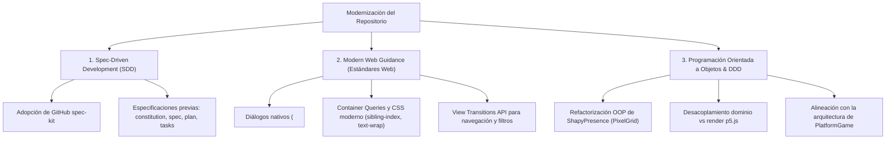
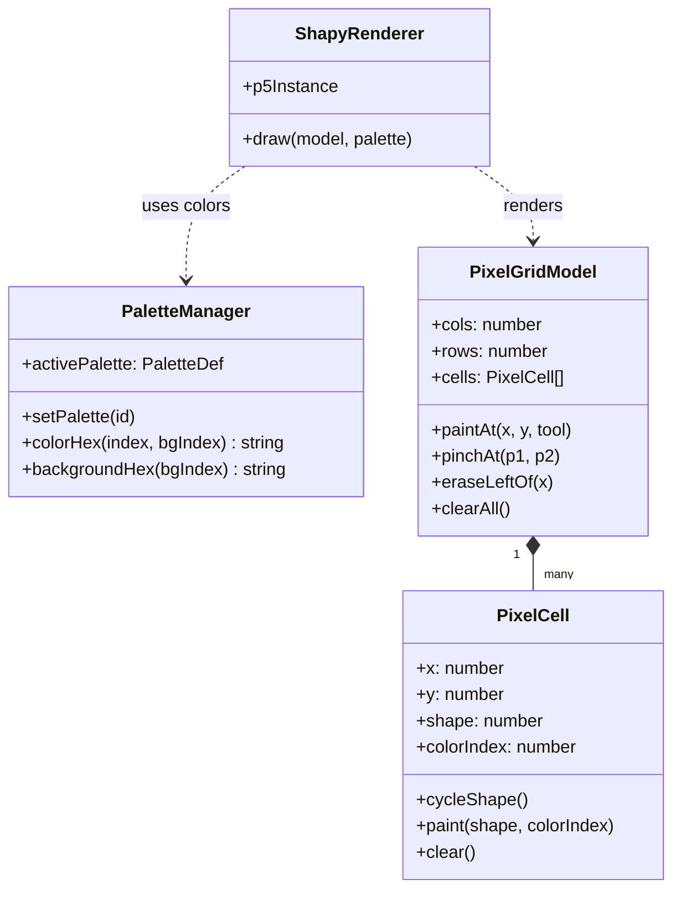

# Plan Maestro de Modernización y Arquitectura: juanolaya.github.io

Este documento central establece la visión arquitectónica, la metodología de desarrollo y el plan de modernización integral para todo el repositorio [`juanolaya.github.io`](./). 

Está diseñado para servir como guía y punto de referencia común tanto para **desarrolladores humanos** como para **agentes de inteligencia artificial (LLMs)**.

---

## 1. Los Tres Pilares de la Modernización



---

## 2. Pilar 1: Spec-Driven Development (SDD) con GitHub `spec-kit`

### 2.1. ¿Por qué Spec-Driven Development?
El desarrollo asistido por IA suele volverse lento y propenso a errores cuando se trabaja mediante instrucciones ad-hoc. **SDD invierte la dinámica**: las especificaciones formales y verificables se escriben primero, convirtiéndose en la fuente única de verdad (*Single Source of Truth*), y el código se genera e implementa para satisfacer la especificación.

### 2.2. Flujo de Trabajo Propuesto (`github.com/github/spec-kit`)
Adoptaremos la estructura de `spec-kit` mediante una carpeta central `.specs/`:

1. **`constitution.md` (Constitución del Repositorio):**
   - Reglas inviolables: TypeScript estricto, cero dependencias pesadas innecesarias, tests automatizados obligatorios (`vitest`), contrato visual oscuro compartido y cache invalidation en MemoDeutsch.
2. **`spec.md` (Especificación funcional):**
   - Define el *qué* y el *por qué* de cada módulo o nueva funcionalidad antes de programar (historias de usuario, entradas, salidas, estados y criterios de aceptación).
3. **`plan.md` (Plano técnico de arquitectura):**
   - Define el *cómo* (entidades de dominio, contratos de interfaces, componentes y diseño modular).
4. **`tasks.md` (Lista ejecutable de tareas):**
   - Desglose granular de pasos secuenciales y verificables para el programador o agente.

---

## 3. Pilar 2: ShapyPresence (PixelGrid) — Diagnóstico de Lentitud y Refactorización OOP

### 3.1. ¿Por qué está tardando hacer cambios y verlos reflejados?
1. **Dependencia del ciclo CI/CD en la nube:**
   - Cada commit activa GitHub Actions, que compila 2.300 módulos, ejecuta MathJax, PWA y 77 suites de tests (~2.5 minutos).
   - *Solución:* Usar el entorno local con `npm run dev`, donde **Vite aplica los cambios en 50 milisegundos (HMR)** sin necesidad de compilar todo ni esperar a GitHub Actions.
2. **Caché agresiva del navegador:**
   - Chrome retiene en memoria los scripts compilados previos (`pixelGrid-*.js`). Probar en una ventana de **Incógnito (`Ctrl + Shift + N`)** o con *Vaciar caché y volver a cargar de manera forzada* refleja los cambios inmediatamente.
3. **Arquitectura procedural plana:**
   - La migración reciente transformó el script original en funciones procedimentales dispersas (`grid.ts`, `input.ts`, `render.ts`), lo que dificulta la extensión y reutilización de estados (como la gestión de múltiples paletas).

### 3.2. Propuesta: Arquitectura Orientada a Objetos (OOP) y DDD
Al igual que se hizo en `PlatformGame` (PR #102), refactorizaremos el módulo `EurekaWall/pixelGrid/` hacia un modelo de objetos limpio y desacoplado del canvas:



* **`PixelCell`:** Entidad que encapsula su geometría, forma (1 a 12), color y estado de animación/pop.
* **`PixelGridModel`:** Agregado raíz del dominio que gestiona la grilla, búsqueda espacial de celdas por coordenadas y transformaciones (redimensionamiento, borrado lateral). No importa p5.js ni el DOM; se testea al 100% con pruebas unitarias puras.
* **`PaletteManager`:** Servicio de dominio responsable de la paleta activa (*Modern* vs *Classic*), indexación de colores y persistencia en `localStorage`.
* **`ShapyRenderer`:** Capa de infraestructura y presentación que consume el dominio y dibuja en el canvas de p5.js.

---

## 4. Pilar 3: Modern Web Guidance en Todo el Repositorio

Implementación de las directrices de [Google Chrome Modern Web Guidance](https://developer.chrome.com/docs/modern-web-guidance) en los módulos clave:

### 4.1. `Haptic_Cards/`
- **Diálogos Nativos (`<dialog>`):** Migrar `IntroModal.vue` y `MediaLightbox.vue` al elemento nativo `<dialog>` con `.showModal()`, backdrop con `overscroll-behavior: contain` y soporte nativo de `Escape`.
- **Container Queries:** `container-type: inline-size` en `.card-item` para que las tarjetas adapten su tipografía y columnas según el ancho de celda real.
- **View Transitions:** `document.startViewTransition()` al paginar y filtrar familias de controladores hápticos.
- **CSS Moderno:** Sustitución de selectores `:nth-child` estáticos por `animation-delay: calc(sibling-index() * 40ms)`.

### 4.2. Portada (`/`) y Proyectos Interactivos (`UX/`, `Project_Management/`, `EurekaWall/`)
- **Estilos Compartidos:** Consolidación de tokens visuales en `src/shared/styles/tokens.css` (colores de superficie, borde, tinta, acentos y radios).
- **Tipografía Moderna:** Aplicación sistemática de `text-wrap: balance` en títulos y `text-wrap: pretty` en cuerpos de texto.

---

## 5. Hoja de Ruta de Ejecución

| Fase | Alcance | Entregable Clave |
| :--- | :--- | :--- |
| **Fase 1: Constitución SDD** | Raíz del proyecto | Creación de `.specs/constitution.md` con los estándares de arquitectura y directrices de testing. |
| **Fase 2: Refactor OOP de ShapyPresence** | `EurekaWall/pixelGrid/` | Modelo de dominio `PixelCell`, `PixelGridModel`, `PaletteManager` con pruebas unitarias desacopladas de p5. |
| **Fase 3: Modern Web en Haptic Cards** | `Haptic_Cards/` | Diálogos nativos `<dialog>`, Container Queries y View Transitions en catálogo. |
| **Fase 4: Consolidación de Tokens Globales** | `src/shared/styles/` | Hoja `tokens.css` centralizada para eliminar redundancias en todos los proyectos. |

---

## 6. Comandos de Verificación y Calidad

Todo cambio derivado de este plan debe cumplir con la suite de verificación obligatoria:

```bash
# 1. Pruebas unitarias de todos los proyectos
npm test

# 2. Análisis estático de ESLint (obligatorio para pasar CI/CD)
npm run lint

# 3. Comprobación de tipos TypeScript y Vue
npm run typecheck

# 4. Generación de artefactos de producción
npm run build
```
