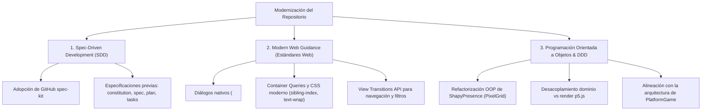
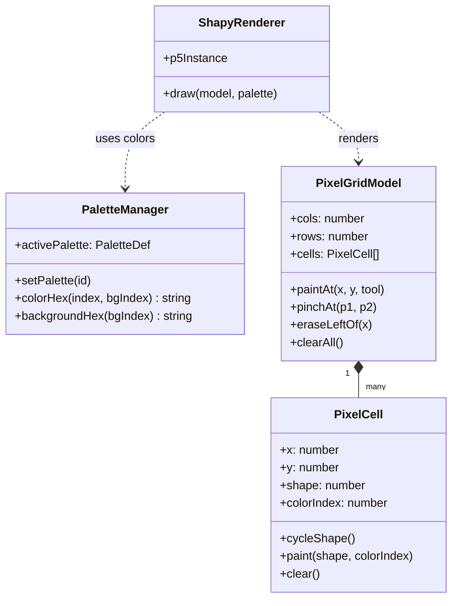
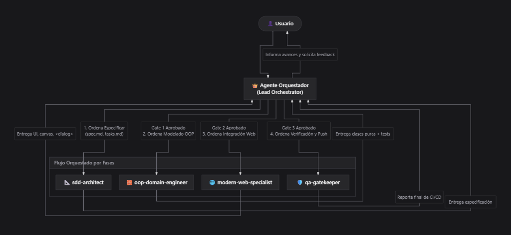
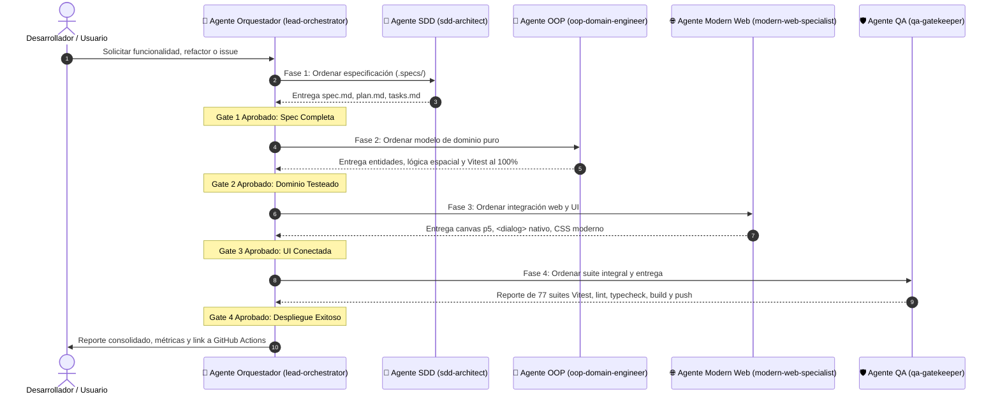

# Plan Maestro de Modernización y Arquitectura: juanolaya.github.io

Este documento central establece la visión arquitectónica, la metodología de desarrollo y el plan de modernización integral para todo el repositorio [`juanolaya.github.io`](./). 

Está diseñado para servir como guía y punto de referencia común tanto para **desarrolladores humanos** como para **agentes de inteligencia artificial (LLMs)**.

---

## 1. Los Tres Pilares de la Modernización



---

## 2. Pilar 1: Spec-Driven Development (SDD) con GitHub `spec-kit`

### 2.1. ¿Por qué Spec-Driven Development?
El desarrollo asistido por IA suele volverse lento y propenso a errores cuando se trabaja mediante instrucciones ad-hoc. **SDD invierte la dinámica**: las especificaciones formales y verificables se escriben primero, convirtiéndose en la fuente única de verdad (*Single Source of Truth*), y el código se genera e implementa para satisfacer la especificación.

### 2.2. Flujo de Trabajo Propuesto (`github.com/github/spec-kit`)
Adoptaremos la estructura de `spec-kit` mediante una carpeta central `.specs/`:

1. **`constitution.md` (Constitución del Repositorio):**
   - Reglas inviolables: TypeScript estricto, cero dependencias pesadas innecesarias, tests automatizados obligatorios (`vitest`), contrato visual oscuro compartido y cache invalidation en MemoDeutsch.
2. **`spec.md` (Especificación funcional):**
   - Define el *qué* y el *por qué* de cada módulo o nueva funcionalidad antes de programar (historias de usuario, entradas, salidas, estados y criterios de aceptación).
3. **`plan.md` (Plano técnico de arquitectura):**
   - Define el *cómo* (entidades de dominio, contratos de interfaces, componentes y diseño modular).
4. **`tasks.md` (Lista ejecutable de tareas):**
   - Desglose granular de pasos secuenciales y verificables para el programador o agente.

---

## 3. Pilar 2: ShapyPresence (PixelGrid) — Diagnóstico de Lentitud y Refactorización OOP

### 3.1. ¿Por qué está tardando hacer cambios y verlos reflejados?
1. **Dependencia del ciclo CI/CD en la nube:**
   - Cada commit activa GitHub Actions, que compila 2.300 módulos, ejecuta MathJax, PWA y 77 suites de tests (~2.5 minutos).
   - *Solución:* Usar el entorno local con `npm run dev`, donde **Vite aplica los cambios en 50 milisegundos (HMR)** sin necesidad de compilar todo ni esperar a GitHub Actions.
2. **Caché agresiva del navegador:**
   - Chrome retiene en memoria los scripts compilados previos (`pixelGrid-*.js`). Probar en una ventana de **Incógnito (`Ctrl + Shift + N`)** o con *Vaciar caché y volver a cargar de manera forzada* refleja los cambios inmediatamente.
3. **Arquitectura procedural plana:**
   - La migración reciente transformó el script original en funciones procedimentales dispersas (`grid.ts`, `input.ts`, `render.ts`), lo que dificulta la extensión y reutilización de estados (como la gestión de múltiples paletas).

### 3.2. Propuesta: Arquitectura Orientada a Objetos (OOP) y DDD
Al igual que se hizo en `PlatformGame` (PR #102), refactorizaremos el módulo `EurekaWall/pixelGrid/` hacia un modelo de objetos limpio y desacoplado del canvas:



* **`PixelCell`:** Entidad que encapsula su geometría, forma (1 a 12), color y estado de animación/pop.
* **`PixelGridModel`:** Agregado raíz del dominio que gestiona la grilla, búsqueda espacial de celdas por coordenadas y transformaciones (redimensionamiento, borrado lateral). No importa p5.js ni el DOM; se testea al 100% con pruebas unitarias puras.
* **`PaletteManager`:** Servicio de dominio responsable de la paleta activa (*Modern* vs *Classic*), indexación de colores y persistencia en `localStorage`.
* **`ShapyRenderer`:** Capa de infraestructura y presentación que consume el dominio y dibuja en el canvas de p5.js.

---

## 4. Pilar 3: Modern Web Guidance en Todo el Repositorio

Implementación de las directrices de [Google Chrome Modern Web Guidance](https://developer.chrome.com/docs/modern-web-guidance) en los módulos clave:

### 4.1. `Haptic_Cards/`
- **Diálogos Nativos (`<dialog>`):** Migrar `IntroModal.vue` y `MediaLightbox.vue` al elemento nativo `<dialog>` con `.showModal()`, backdrop con `overscroll-behavior: contain` y soporte nativo de `Escape`.
- **Container Queries:** `container-type: inline-size` en `.card-item` para que las tarjetas adapten su tipografía y columnas según el ancho de celda real.
- **View Transitions:** `document.startViewTransition()` al paginar y filtrar familias de controladores hápticos.
- **CSS Moderno:** Sustitución de selectores `:nth-child` estáticos por `animation-delay: calc(sibling-index() * 40ms)`.

### 4.2. Portada (`/`) y Proyectos Interactivos (`UX/`, `Project_Management/`, `EurekaWall/`)
- **Estilos Compartidos:** Consolidación de tokens visuales en `src/shared/styles/tokens.css` (colores de superficie, borde, tinta, acentos y radios).
- **Tipografía Moderna:** Aplicación sistemática de `text-wrap: balance` en títulos y `text-wrap: pretty` en cuerpos de texto.

---

## 5. Arquitectura de Agentes de IA (Multi-Agent Team)

Para ejecutar este plan con máxima velocidad, trazabilidad y cero degradación de calidad, se adopta un modelo **Hub-and-Spoke (Director de Orquesta)** gobernado por un Agente Orquestador y cuatro agentes especialistas:





### 5.1. Catálogo de Agentes

#### 👑 Agente Director: `lead-orchestrator` (Chief Conductor)
* **Objetivo:** Actuar como el único punto de contacto con el desarrollador, gobernar la máquina de estados del proyecto, asignar contexto exacto a cada especialista y validar los *Quality Gates* antes de pasar a la siguiente fase.
* **Responsabilidades:**
  - Descomponer requerimientos complejos en tickets atómicos mapeados a la hoja de ruta.
  - Invocar secuencialmente a los agentes especialistas (`invoke_subagent` / `send_message`).
  - Proteger los contextos de los agentes entregando únicamente los artefactos de la fase anterior (sin ruido de conversaciones pasadas).
  - Gestionar bucles de retroalimentación: si la UI encuentra un vacío conceptual en el modelo de objetos, reabre la tarea con `oop-domain-engineer` con la duda delimitada en vez de permitir soluciones parche en la vista.
  - Consolidar el informe ejecutivo final hacia el usuario con trazabilidad completa.
* **Criterio de éxito:** Flujo de trabajo 100% coordinado, sin desalineaciones de especificación ni regresiones de código.

#### 📐 Agente 1: `sdd-architect` (Spec-Driven Architect)
* **Objetivo:** Asegurar que ninguna línea de código se escriba sin especificación previa verificable, siguiendo la metodología de [`github/spec-kit`](https://github.com/github/spec-kit).
* **Responsabilidades:**
  - Crear y mantener `.specs/constitution.md` (principios inviolables: TypeScript estricto, cero dependencias innecesarias, tests automatizados obligatorios, invalidación de caché).
  - Redactar especificaciones funcionales (`spec.md`) con historias de usuario, entradas, salidas, invariantes y criterios de aceptación.
  - Generar el desglose de tareas ejecutables (`tasks.md`) para los demás agentes.
* **Criterio de éxito:** Cualquier desarrollador o agente puede implementar la funcionalidad basándose únicamente en la especificación, sin ambigüedades.

#### 🧱 Agente 2: `oop-domain-engineer` (Domain-Driven Object Engineer)
* **Objetivo:** Modelar la lógica de negocio y simulación física mediante Programación Orientada a Objetos y Domain-Driven Design (DDD), completamente desacoplada de frameworks de renderizado o del DOM.
* **Responsabilidades:**
  - Diseñar entidades y agregados ricos con alta cohesión y bajo acoplamiento (ej. `PixelCell`, `PixelGridModel`, `PaletteManager`).
  - Separar estrictamente el **Dominio** (coordenadas, reglas de pintura, ciclos de formas, transformaciones espaciales) de la **Infraestructura** (canvas, p5.js, eventos de puntero).
  - Escribir pruebas unitarias puras y deterministas en Vitest que validen el dominio sin necesidad de simular el navegador.
* **Criterio de éxito:** Cobertura del 100% de la lógica de dominio ejecutable de forma instantánea en Node/Vitest.

#### 🌐 Agente 3: `modern-web-specialist` (Frontend Standards Specialist)
* **Objetivo:** Aplicar las directrices de [Google Chrome Modern Web Guidance](https://developer.chrome.com/docs/modern-web-guidance) y estándares W3C modernos en los componentes de usuario.
* **Responsabilidades:**
  - Conectar el modelo de dominio con la capa de presentación (renderizado p5.js y UI del navegador).
  - Migrar modales y capas superpuestas al elemento nativo `<dialog>` con `.showModal()`, backdrop nativo y manejo accesible de teclado.
  - Implementar Container Queries (`@container`) para diseño responsivo modular y View Transitions API para transiciones fluidas.
  - Aplicar tokens visuales centralizados y tipografía moderna (`text-wrap: balance / pretty`).
* **Criterio de éxito:** Cero hacks de CSS/JS para funcionalidades que la plataforma web ya ofrece de forma nativa.

#### 🛡️ Agente 4: `qa-gatekeeper` (Verification & Deployment Sentinel)
* **Objetivo:** Proteger la estabilidad del repositorio, aplicar las reglas del proyecto y garantizar despliegues continuos sin fallos.
* **Responsabilidades:**
  - Ejecutar la suite integral de calidad: `npm test` (77 suites / 674 tests), `npm run lint` y `npm run typecheck`.
  - Aplicar las reglas obligatorias del repositorio (como la invalidación de índices en `Deutsch_lernen/verben/A1_A2_B1/json/verbs_index.json`).
  - Generar builds de producción (`npm run build`) para verificar la compilación de Vite y PWA.
  - Realizar commits atómicos y descriptivos y desplegar a la rama remota (`git push origin master`).
* **Criterio de éxito:** Cero fallos en GitHub Actions CI/CD y despliegue exitoso en GitHub Pages.

---

## 6. Hoja de Ruta de Ejecución

| Fase | Alcance | Agente Responsable | Entregable Clave |
| :--- | :--- | :--- | :--- |
| **Fase 0: Orquestación del Flujo** | Todo el repositorio | `lead-orchestrator` | Matriz de Quality Gates y asignación de tareas a especialistas. |
| **Fase 1: Constitución SDD** | Raíz del proyecto | `sdd-architect` | Creación de `.specs/constitution.md` y estructura de especificación. |
| **Fase 2: Refactor OOP de ShapyPresence** | `EurekaWall/pixelGrid/` | `oop-domain-engineer` | Modelo de dominio `PixelCell`, `PixelGridModel`, `PaletteManager` con tests puros. |
| **Fase 3: Modern Web en Haptic Cards** | `Haptic_Cards/` | `modern-web-specialist` | Diálogos nativos `<dialog>`, Container Queries y View Transitions en catálogo. |
| **Fase 4: Consolidación de Tokens Globales** | `src/shared/styles/` | `modern-web-specialist` | Hoja `tokens.css` centralizada para eliminar redundancias en todos los proyectos. |
| **Fase 5: Verificación Continua y Despliegue** | Todo el repositorio | `qa-gatekeeper` | Ejecución de pipelines, validación cruzada y entrega en GitHub Pages. |

---

## 7. Comandos de Verificación y Calidad

Todo cambio derivado de este plan debe cumplir con la suite de verificación obligatoria:

```bash
# 1. Pruebas unitarias de todos los proyectos
npm test

# 2. Análisis estático de ESLint (obligatorio para pasar CI/CD)
npm run lint

# 3. Comprobación de tipos TypeScript y Vue
npm run typecheck

# 4. Generación de artefactos de producción
npm run build
```
